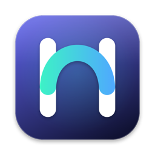
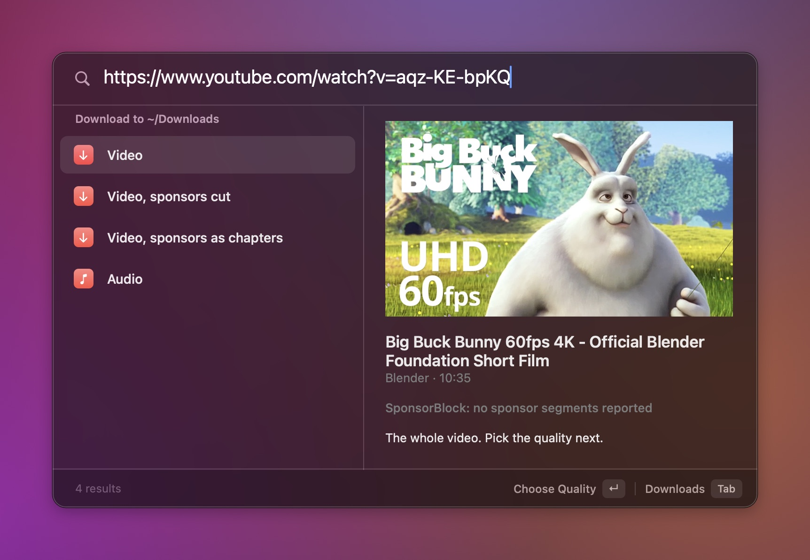
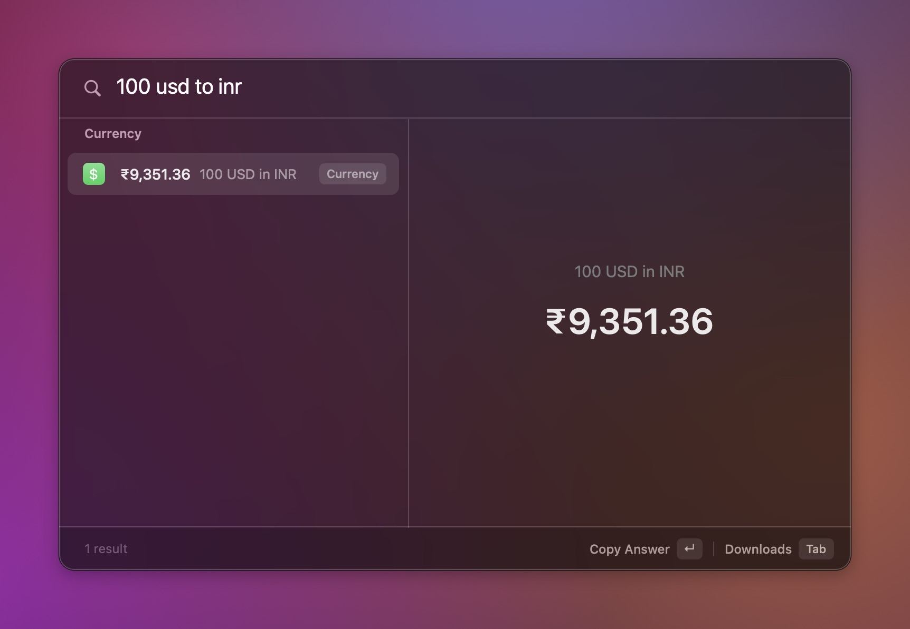
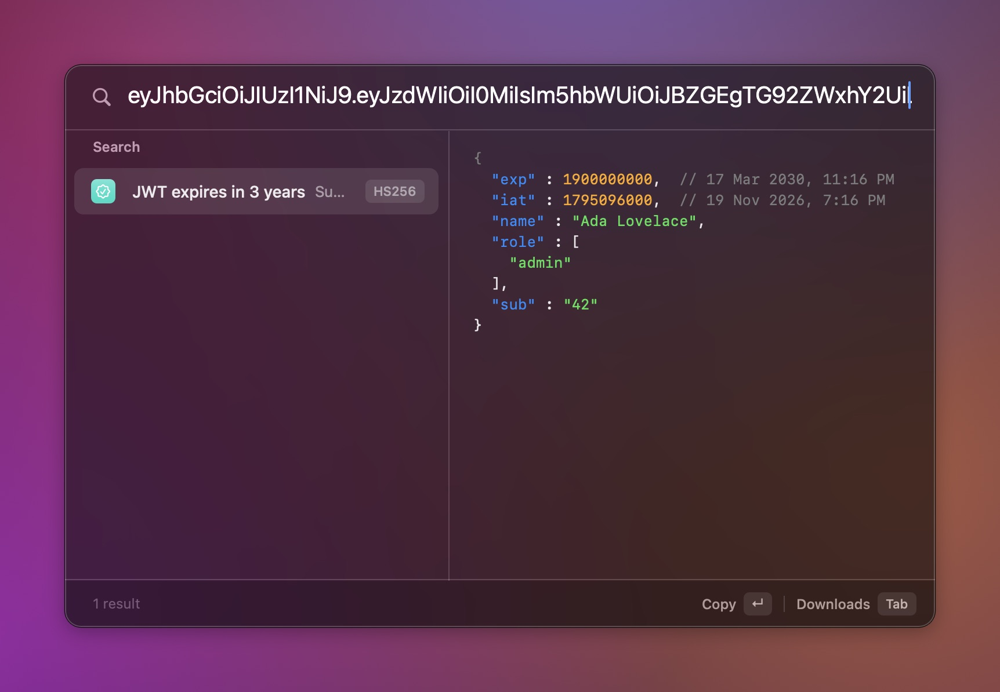
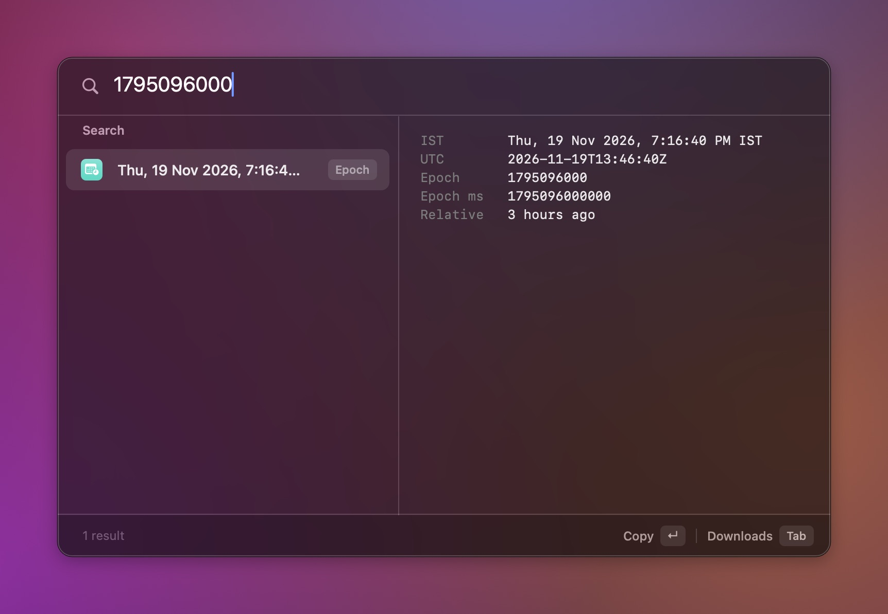
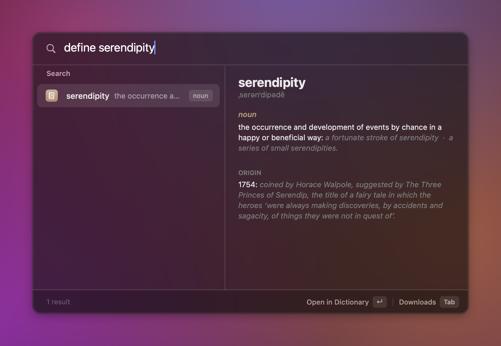

<div align="center">



# Hop

**A blazingly fast, native macOS launcher. ⚡**

Apps, clipboard history, a calculator, decoders, a dictionary, a video downloader and dev tools, in one 0.9 MB app with zero dependencies.




</div>

## 🔥 Why Hop

- ⚡ **Every keystroke answers in under 0.3 ms.** Typing `saf`, `100 usd to inr` or `define hop` takes 0.18 to 0.27 ms on an M4 Pro, measured over 200 runs each.
- 🪶 **0.9 MB, no dependencies.** It is plain Swift and AppKit, with no Electron and no web views. Release builds are stripped like App Store builds, and the function names go to `build/Hop.dSYM` so crash reports stay readable.
- 🧊 **Nothing slow touches the main thread.** git, gh, docker, process sampling, port scans, image decoding and disk writes all run in the background. When idle, Hop sits at 0.0% CPU.
- 🧩 **Everything is a plugin.** Each feature is one Swift file in `Sources/Plugins/`.

## 🚀 Install

```sh
git clone https://github.com/kratos-respawned/hop.git
cd hop
./build.sh install
```

You need the Xcode command line tools (`xcode-select --install`). The script runs the fuzzy-match check, builds, signs and copies Hop to `~/Applications`, then starts it. For video downloads, also run `brew install yt-dlp ffmpeg`.

Press `⌥ Space` to open Hop and `⌥ V` for clipboard history. You can change the `⌥ Space` shortcut in Settings.

## ✨ What it does

<table>
<tr>
<td width="50%"></td>
<td width="50%"></td>
</tr>
<tr>
<td><b>🧮 Calculator and currency</b><br>Type <code>2^10</code>, <code>150 + 10%</code>, <code>20% off 150</code> or <code>100 usd to inr</code>. Enter copies the answer.</td>
<td><b>🔐 JWT and Base64 decoder</b><br>Paste a token and see when it expires, with the payload coloured and IST times beside <code>exp</code> and <code>iat</code>.</td>
</tr>
<tr>
<td></td>
<td></td>
</tr>
<tr>
<td><b>🕒 Time decoder</b><br>Paste an epoch (seconds or ms) or an ISO date to get IST, UTC and how long ago. <code>now</code> gives the current epoch.</td>
<td><b>📖 Dictionary</b><br><code>define serendipity</code> shows the full entry from the Mac's built-in Oxford dictionary, offline.</td>
</tr>
</table>

### 🔎 App search

`⌥ Space` searches apps with fuzzy matching on prefixes, word starts and initials (`vsc`, `ws`). Apps you open often rank higher.

### 📋 Clipboard history

`⌥ V` keeps the last 300 text and image entries, with a preview of the selected one. Items that password managers mark as concealed are never saved.

### 🎬 Video downloader

Paste a YouTube, Instagram, X, Reddit, Vimeo, TikTok or similar link. Pick the video, the video with SponsorBlock cutting sponsor reads, the video with sponsors marked as chapters, or audio only. Hop then lists the qualities the video really has, with their sizes, and puts 1080p first.

- Up to 1080p it picks h264, which plays everywhere. Above that YouTube only offers AV1 or VP9, and QuickTime plays AV1 only on M3 or newer Macs.
- Audio comes as m4a (no re-encode) or mp3.
- The preview shows the thumbnail, title, channel, length and how much of the video SponsorBlock marks as sponsors. That check sends SponsorBlock only the first 4 characters of a hash of the video ID.
- Files go to `~/Downloads`. Type `downloads` to watch progress, stop a download or show it in Finder. A notification says when one finishes.

### 📤 AirDrop shelf at the notch

Start dragging files from Finder, the Desktop or any app and an island springs out of the notch. Drop them on it, from as many folders as you like. It shrinks to a pill beside the notch with the file count. Hover it and AirDrop everything in one send. The shelf keeps the files after a send, so a cancelled AirDrop loses nothing. Type `shelf` to remove files, clear the shelf or tuck the pill away.

### 🛠️ Dev tools

<details>
<summary><b>🔥 Metal Manager</b> (type <code>metal</code>): what is heating your Mac</summary>

<br>

Shows CPU and memory grouped by app, so Chrome's 20 helpers count as one row. The memory number is the same footprint Activity Monitor shows. Each row also shows the share of RAM, CPU and power in watts, read from the kernel through libproc in about 3 ms for every process.

When something is heavy, a Worth quitting section comes first. It lists apps above 40% CPU, apps holding a fifth of your RAM, and every app above 1 GB once memory is 85% full. If one app stays above 80% CPU for 2 minutes, Hop sends a notification. Enter offers Quit, Force Quit, or force quitting a single process. Each process shows its folder, so you can tell which `node` belongs to which project.

</details>

<details>
<summary><b>🔌 Port Manager</b> (type <code>port</code>, or <code>:3000</code> in the search)</summary>

<br>

Lists every listening TCP port with the command and folder behind it, read in about 5 ms. Docker ports show their container name. Enter opens localhost, stops the server (and the npm or nodemon that would restart it), force stops it, or shows its folder. Docker rows stop the container with `docker stop`.

</details>

<details>
<summary><b>🌳 Worktree Manager</b> (type <code>worktree</code>)</summary>

<br>

Lists every repo in `~/Desktop/work` with its git worktrees, their size and how much of that is build artifacts. Each worktree gets a merge badge (In main, In uat, Not merged, Uncommitted) and its PR status from `gh`. Enter opens it in WebStorm or a terminal, runs `npm run dev`, clears `node_modules` and other ignored build folders, or deletes the worktree.

A Recommended section lists what is safe to clean, biggest first. A worktree with uncommitted or unpushed work is never recommended for delete.

The folder and the `main` and `uat` branches are fixed for now.

</details>

<details>
<summary><b>☕ Claude Manager</b> (type <code>claude</code>)</summary>

<br>

Lists running Claude Code sessions with their folder, whether they are working or idle, and their subagents. Enter caffeinates a session, which keeps the Mac awake even with the lid closed, until that session finishes. The first time, it asks for your password once to add `/etc/sudoers.d/hop`. That rule lets your user run only `pmset -a disablesleep 1`, `pmset -a disablesleep 0` and `pmset sleepnow`.

</details>

## ⌨️ Keys

| Key | Does |
| --- | --- |
| `⌥ Space` | Open Hop |
| `⌥ V` | Clipboard history |
| `↑` `↓` | Move the selection |
| `⌘ ↑` `⌘ ↓` | Jump to the previous or next group |
| Hold `⌘` | Show `⌘1` to `⌘9` beside rows, then press a number to open one |
| `Tab` | Switch page |
| `Enter` | Open, copy or paste |
| `Esc` | Go back, or close |

Each plugin also appears as a command in the search. Type `clip` and press Enter to open Clipboard History. Type `quit hop` to quit.

## 🧩 Write a plugin

Every feature is a plugin in `Sources/Plugins/`, and the contract is in `Sources/Plugin.swift`. In `register(in:)` a plugin tells Hop what it adds:

- `add(search:)` adds results to the main search, like the calculator.
- `add(page:)` adds a page with its own list, an optional hotkey and an optional preview, like Clipboard History.
- `add(command:)` adds a named action, like Quit Hop.

```swift
final class EmojiPlugin: Plugin, SearchProvider {
    func register(in hop: PluginRegistry) { hop.add(search: self) }
    func search(_ query: String) -> [Item] { ... }
}
```

Add it to the `PluginManager([...])` list in `Sources/main.swift`. The list's order is the order of results. A page whose results change in the background posts `.pageChanged` and Hop refreshes it.

## 🔒 Permissions

- **Accessibility** lets Enter paste straight into the frontmost app. Without it, Enter only copies.
- `build.sh` signs Hop with the first Apple Development identity in your keychain, so macOS keeps its permissions across rebuilds. Without one it signs ad hoc, and each rebuild resets them.
- Exchange rates come from open.er-api.com, refresh every 6 hours and are cached for offline use. Calculations, decodes, definitions and downloads never go into Recent.

## License

Personal, non-commercial use only. No redistribution, no ports or clones, and no AI-assisted copying. See [LICENSE](LICENSE).
